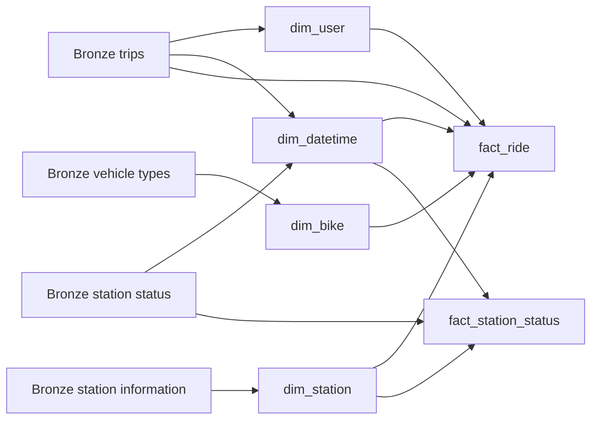

# Reproduce the report analysis

This folder contains the six refined business-question queries, their recorded results and the Airflow overview used in the report.

- [Run the read-only queries](reporting/queries.sql)
- [Recorded CSV results](reporting/results)
- [Airflow overview](reporting/airflow-overview.png)
- [Requirement review / AAR](reporting/REVIEW.md)
- [Implemented schema](star_schema/README.md)

## 1. Start the project

Install Git and Docker with Docker Compose. Clone the project and start the services:

```bash
git clone https://github.com/ihromovyi/Data-Engineering-UT.git
cd Data-Engineering-UT/Part2
docker compose up --build -d
```

 The analytical database is `bikes_db`; the dbt target schema is `gold`.

The custom Airflow image installs dbt Core 1.8.7, dbt-postgres 1.8.2 and the PostgreSQL provider. The Compose file mounts the dbt project at `/dbt`.

If dbt reports permission denied for `/dbt/logs/dbt.log`, repair ownership of its generated output folders on the deployed computer:

```bash
docker compose exec --user root airflow-scheduler bash -c "mkdir -p /dbt/logs /dbt/target && chown -R airflow:0 /dbt/logs /dbt/target && chmod -R u+rwX /dbt/logs /dbt/target"
```

This changes generated log/artifact folder permissions, not source data or analytical tables.

## Credentials

| Component      | Username            | Password      | Port |
| -------------- | ------------------- | ------------- | ---- |
| **airflow-db** | `airflow`           | `airflow`     | 5432 |
| **prices-db**  | `bikes_user`       | `bikes_pass` | 5433 |
| **pgAdmin**    | `admin@example.com` | `admin`       | 5050 |

Access pgAdmin at:  
[http://localhost:5050](http://localhost:5050)

Access Airflow at:  
[http://localhost:8080](http://localhost:8080)

Connecting `prices-db` through PgAdmin

| Field                    | Value                                                |
| ------------------------ | ---------------------------------------------------- |
| **Host name / address**  | `bikes-db` *(use service name from docker-compose)* |
| **Port**                 | `5432`                                               |
| **Maintenance database** | `bikes_db`                                          |
| **Username**             | `bikes_user`                                        |
| **Password**             | `bikes_pass`                                        |

## 2. Ingest sources and build Gold

1. Open Airflow at `http://localhost:8080`.
2. Run `trip_datasets_loader`, `stations_informations_loader`, `stations_status_loader` and `bikes_types_loader`. Wait for source loading and quality checks to finish.
3. Trigger `dbt_pipeline`. Its task is named `dbt_snapshot`, but its actual command is `dbt build --no-use-colors --project-dir /dbt --profiles-dir /dbt`.
4. Check the task log for successful models and tests. The recorded report run built **6 models** and passed **18 tests**; `PASS=24` includes both.

Trip ingestion is scheduled monthly on the 27th, API ingestion every minute and dbt every ten minutes. The dbt DAG does not automatically wait for source DAGs, so source completion must currently be checked before building Gold.

The trip loader chooses the previous month using the computer's current date. Changing an Airflow logical date or passing an unused trigger configuration does not select a historical month. The row-by-row trip load can take considerable time. If it fails, an existing load marker may cause later runs to skip incomplete data; see the AAR before treating that as a completed load.

## 3. Run the business queries

1. Open pgAdmin at `http://localhost:5050`.
2. Select `bikes_db`, open **Query Tool**, and open or paste this folder's [queries.sql](reporting/queries.sql).
3. Select one query and execute it. Export the result grid as CSV if needed.
4. Change both date boundaries when analysing a different input month.

Use this folder's queries for the implemented model. The repository-root `queries.sql` belongs to Project 1 and includes old DDL; it is not the Gold reporting script.

| Business question | Recorded result file |
| --- | --- |
| BQ1. Departures per dock | [station_departures.csv](reporting/results/station_departures.csv) |
| BQ2. Busy hours on weekdays/weekends | [hourly_weekday_weekend.csv](reporting/results/hourly_weekday_weekend.csv) |
| BQ3. Morning net outflow, 07:00–09:00 | [morning_outflow.csv](reporting/results/morning_outflow.csv) |
| BQ4. Evening net inflow, 17:00–19:00 | [evening_inflow.csv](reporting/results/evening_inflow.csv) |
| BQ5. Station departures by bike type | [station_bike_types.csv](reporting/results/station_bike_types.csv) |
| BQ6. Routes between different stations | [top_routes_distinct.csv](reporting/results/top_routes_distinct.csv) |

Time windows use the recorded trip timestamps. Weekdays are derived with `EXTRACT(ISODOW ...)`, not the day-of-month field. BQ3/BQ4 count arrivals by arrival time and departures by departure time. BQ6 excludes same-station round trips. All station queries omit trips without the station matches they need; capacity ratios use positive capacities from the latest station-information table.

## What can be reproduced

The code, method and recorded outputs are in GitHub. The recorded warehouse contained **356,772 unique rides starting 1–15 October 2026**; the source load was incomplete. Station metadata was captured in November. The report's first two examples are selected results from these files.

External APIs change, the loader selects input from the current date and the exact partial trip snapshot is not bundled here. A fresh run therefore need not reproduce these numerical results exactly. The CSVs preserve the observed outputs; complete fixed-input replay remains an implementation gap.

The raw data sources are the [Citi Bike trip archive](https://s3.amazonaws.com/tripdata/index.html) and [GBFS discovery API](https://gbfs.citibikenyc.com/gbfs/2.3/gbfs.json).

## dbt model dependencies

The following diagram follows the implemented `source()` and `ref()` calls. It describes dependencies rather than claiming that source and transformation DAGs are connected automatically.


