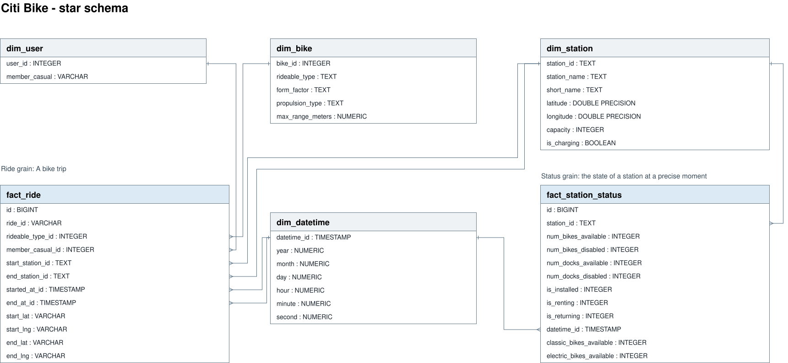

# Implemented Citi Bike Gold schema

[Open the editable draw.io file](20261112_star_schema.drawio) · [Open the full-size preview](20261112_star_schema.svg)



This diagram documents the current [dbt models](../citibike_dbt/models), reviewed against commit `ef1a2d7dd08f076790485f3b162dfc3adc9acedd`. It includes all **6 tables, 45 columns and 8 role-specific join relationships**. The filename of the existing draw.io document is retained so existing links remain valid.

## Tables and grain

| Table | Grain / purpose | Join identifier |
| --- | --- | --- |
| `gold.fact_ride` | Intended one row per completed ride; includes endpoint coordinates. | `ride_id` is the source business identifier; `id` is generated with `ROW_NUMBER()`. |
| `gold.fact_station_status` | One expanded vehicle-type entry per station from the latest status payload. | Generated `id`; joins station and reporting timestamp. The source vehicle-type ID is not retained. |
| `gold.dim_bike` | One distinct projected vehicle-type record from the latest vehicle-types payload. | `bike_id`; the Bronze-to-fact mapping uses `rideable_type`. |
| `gold.dim_user` | One distinct rider category (`member` / `casual`). | Generated `user_id`. This is not a dimension of individual customers. |
| `gold.dim_station` | One station record from the latest information payload. | Source `station_id`; trip endpoint codes match `short_name` when the fact is built. |
| `gold.dim_datetime` | One distinct timestamp observed in trip starts, trip ends or station reports. | `datetime_id` is a timestamp, with numeric date/time components. |

## Relationships

- `fact_ride.rideable_type_id` → `dim_bike.bike_id`.
- `fact_ride.member_casual_id` → `dim_user.user_id`.
- `fact_ride.start_station_id` and `end_station_id` → `dim_station.station_id`.
- `fact_ride.started_at_id` and `end_at_id` → `dim_datetime.datetime_id`.
- `fact_station_status.station_id` → `dim_station.station_id`.
- `fact_station_status.datetime_id` → `dim_datetime.datetime_id`.

These are **logical SQL joins**, not database-enforced PK/FK constraints. The [YAML](../citibike_dbt/models/gold_schema.yml) declares selected uniqueness and not-null tests. Their execution results must be obtained from the working deployment.

## Differences from the original design

- Four implemented dimensions; no separate `Dim_vehicle_types_available` table. Classic/electric counts are projected into `fact_station_status`.
- Source station IDs and timestamp date-time keys replace proposed integer surrogate keys for those dimensions.
- Latest station attributes replace the proposed Type 2 station history. `is_current`, `valid_from` and `valid_to` are not implemented columns.
- The status model selects only the latest payload. It does not expose the full history of Bronze snapshots.
- Ride coordinates remain `VARCHAR` because the fact selects the raw Bronze fields without casts. Station coordinates are cast to `DOUBLE PRECISION`.

## Aggregation and identity notes

`fact_station_status` expands `vehicle_types_available` before projecting station-wide counts. A station may therefore have multiple rows with repeated bike/dock totals. Do not sum those totals across vehicle-type entries as if they were separate station observations. The classic/electric columns are populated conditionally on the expanded type entry.

The intended ride grain depends on each source `rideable_type` matching exactly one bike-dimension row. Multiple vehicle IDs mapped to the same label can multiply ride rows. Verify source-to-fact counts and ride uniqueness in the deployed database.

## Edit and confirm

1. In diagrams.net / draw.io, select **File → Open from → Device** and choose `20261112_star_schema.drawio`.
2. Each table, column and relationship is independently editable. Update the diagram when model SQL changes and refresh the SVG preview.
3. The displayed types follow dbt SQL expressions and [Bronze DDL](../tables/create_tables.sql). Confirm the deployed database matches the source using:

```sql
SELECT table_name, ordinal_position, column_name, data_type
FROM information_schema.columns
WHERE table_schema = 'gold'
ORDER BY table_name, ordinal_position;
```

Source review establishes the documented model structure, not successful execution on another computer.
